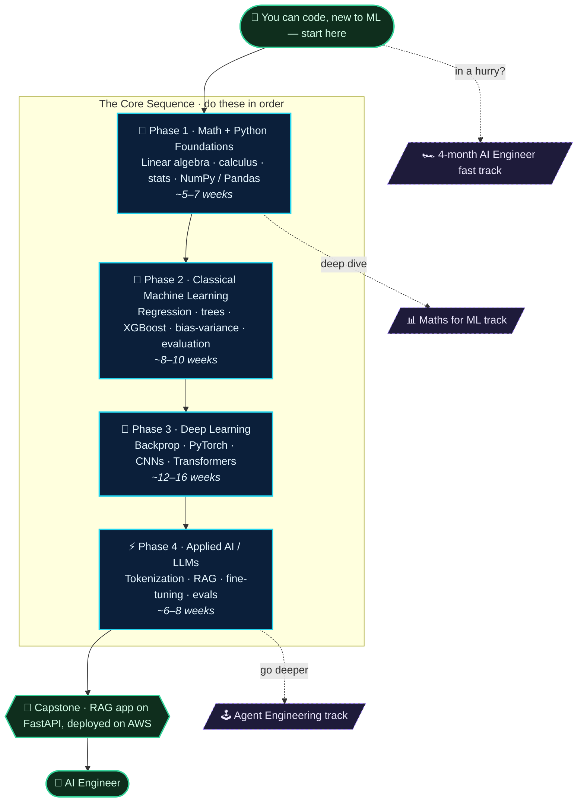

# Road to AI Engineer

A distilled, organized knowledge base for going from software engineer to **AI
Engineer** — curated roadmaps for Machine Learning, Deep Learning, AI
Engineering, and the Maths for ML, with courses, playlists, and reference
resources split into their own files.

## The roadmap at a glance

> **Where to start:** you can already code but are new to ML → begin at
> **Phase 1** and move top to bottom. The dotted branches are specialized tracks
> you can dip into along the way.



**Diagram → files:** Phases 1–4 are the [Personalised roadmap](roadmaps/personalized-ml-dl-ai/README.md) · [Maths for ML](roadmaps/maths-for-ml.md) · [Agent Engineering](roadmaps/agent-engineering-roadmap.md) · [4-month fast track](roadmaps/ai-engineer-roadmap.md). At every stage, pull specifics from [courses](courses.md), [playlists](playlists.md), and [resources](resources.md).

## Contents

### 🗺️ Roadmaps
- [Personalised AI + ML + DL Roadmap](roadmaps/personalized-ml-dl-ai/README.md) — the primary phase-by-phase path (Math → Classical ML → Deep Learning → Applied AI). Kept intact.
  - [Phase 1: Math + Python Foundations](roadmaps/personalized-ml-dl-ai/phase-1-math-python.md)
  - [Phase 2: Classical Machine Learning](roadmaps/personalized-ml-dl-ai/phase-2-classical-ml.md)
  - [Phase 3: Deep Learning](roadmaps/personalized-ml-dl-ai/phase-3-deep-learning.md)
  - [Phase 4: Applied AI Engineering / LLM Layer](roadmaps/personalized-ml-dl-ai/phase-4-applied-ai-eng.md)
- [AI Engineer Roadmap (4-Month Fast Track)](roadmaps/ai-engineer-roadmap.md)
- [Agent Engineering Roadmap (~42 Weeks)](roadmaps/agent-engineering-roadmap.md)
- [Maths for ML Roadmap](roadmaps/maths-for-ml.md)
- [Full AI Engineering Curriculum (18–24 Months)](roadmaps/full-curriculum-18-24mo.md)
- [Community Study Approaches](roadmaps/community-study-approaches.md) — how experienced people actually studied ML.

### ✅ Study tracker
- [Study Tracker](study-tracker/README.md) — my Phase 0–5 working folder: per-phase notes, exercises, projects, checkpoints, and a daily log.

### 📚 Reference
- [Courses](courses.md) — structured courses, specializations, MIT/Stanford lecture series.
- [Playlists](playlists.md) — topical / creator YouTube playlists.
- [Resources](resources.md) — books, papers, sites, tool docs, repos, blogs, tweets, Reddit, and math platforms.

## How to use this

The recommended learning style here: **treat books as the primary source and
courses as guided demonstrations.** For each phase:

1. Read the book chapter.
2. Watch the corresponding lecture(s) only if a concept isn't clear.
3. Implement the algorithm or model yourself.
4. Build a project.
5. Write a short note or post explaining the concept.

A few principles that recur across the roadmaps:

- **Math is intuition, not proofs** — learn enough to debug and tune, not to derive from scratch.
- **Don't jump to deep learning** — classical ML (regression, trees, the bias-variance trade-off) is the foundation.
- **Depth-wise learning** — build a concrete project and learn what it requires on demand; avoid tutorial hell.
- **Ship in public** — publish projects, write architecture breakdowns; the portfolio is the hiring signal.

## Structure

```
.
├── README.md              ← you are here
├── courses.md
├── playlists.md
├── resources.md
└── roadmaps/
    ├── personalized-ml-dl-ai/   (the primary roadmap, kept intact)
    ├── ai-engineer-roadmap.md
    ├── agent-engineering-roadmap.md
    ├── maths-for-ml.md
    ├── full-curriculum-18-24mo.md
    └── community-study-approaches.md
```
